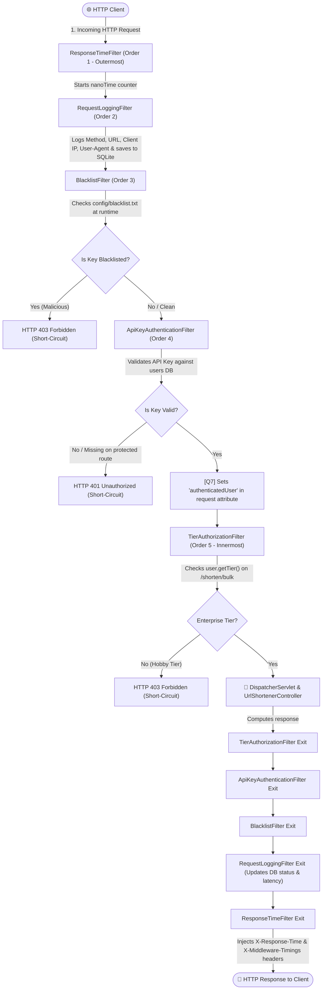

# 🛡️ VYSONM2A3: Middlewares Architecture & Implementation

> **Branch:** [`feature/m2a3-middlewares`](https://github.com/AkshayMadan098/Backend-projects/tree/feature/m2a3-middlewares)  
> **Project:** URL Shortener & Analytics Platform (Milestone 2, Assignment 3)  
> **Tech Stack:** Java 21 (LTS), Spring Boot 3.3.5, Spring Data JPA, Hibernate 6, SQLite 3 (WAL mode), JUnit 5, MockMvc  
> **Test Status:** ✅ **21/21 Automated Tests Passing** (12 Core Tests + 9 Dedicated Middleware Tests)

---

## 📑 Table of Contents

- [💡 What is Middleware?](#-what-is-middleware)
- [🏗️ Middleware Pipeline Architecture](#️-middleware-pipeline-architecture)
- [📊 Assignment Checklist & Features Summary](#-assignment-checklist--features-summary)
- [[Q1] Request Logging Middleware](#q1-request-logging-middleware)
- [[Q2] Route-Specific Middleware Execution](#q2-route-specific-middleware-execution)
- [[Q3] Authentication Middleware (API Key Validation)](#q3-authentication-middleware-api-key-validation)
- [[Q4] Authorization Middleware (Enterprise Tier Check on Bulk Endpoint)](#q4-authorization-middleware-enterprise-tier-check-on-bulk-endpoint)
- [[Q5] Blacklist Middleware with Dynamic Runtime Config File](#q5-blacklist-middleware-with-dynamic-runtime-config-file)
- [[Q6] Response Time Middleware (Elapsed Duration Header)](#q6-response-time-middleware-elapsed-duration-header)
- [[Q7] Context Passing Between Middlewares (Zero Redundant DB Queries)](#q7-context-passing-between-middlewares-zero-redundant-db-queries)
- [[Q8] Middleware Chaining & Execution Order](#q8-middleware-chaining--execution-order)
- [[Q9 BONUS] Timing Each Middleware for Internal Tracking](#q9-bonus-timing-each-middleware-for-internal-tracking)
- [🧪 Running the Integration Test Suite](#-running-the-integration-test-suite)
- [📁 Middleware Source Code Structure](#-middleware-source-code-structure)
- [🔗 Monorepo Navigation](#-monorepo-navigation)

---

## 💡 What is Middleware?

In backend web development, **middleware** is a software component that intercepts HTTP requests and responses as they travel through an application's execution pipeline. It sits directly between the web server / network layer and the controller route handlers.

### Core Mechanics

A middleware operates in two distinct phases around every request:

1. **Pre-Processing (Inbound Request):**
   * Executes **before** the controller endpoint logic is triggered.
   * Can inspect, validate, or modify the incoming `HttpServletRequest` (e.g., headers, query parameters, payload).
   * **Authentication & Authorization:** Verifies security tokens, API keys, or session identities.
   * **Short-Circuiting:** If a request fails validation (e.g., missing API key, blacklisted client, invalid permission), the middleware terminates execution immediately and returns an HTTP error response (such as `401 Unauthorized` or `403 Forbidden`). Control never reaches the controller.
   * **Context Enrichment:** Can attach extracted data to the request context (e.g., `request.setAttribute("authenticatedUser", user)`) so downstream components can access it without redundant database queries.

2. **Delegation:**
   * Invokes the next component in the chain via `filterChain.doFilter(request, response)`.

3. **Post-Processing (Outbound Response):**
   * Executes **after** the controller finishes and returns the response, but **before** bytes are transmitted back to the client.
   * Can inspect the response status code and body.
   * Can inject or mutate HTTP headers (e.g., security headers, CORS headers, `X-Response-Time`).
   * Can log metrics, calculate elapsed execution latency, or handle compression (Gzip).

### Why Use Middleware?

* **Centralization of Cross-Cutting Concerns:** Eliminates code duplication by abstracting shared requirements (logging, authentication, rate-limiting, CORS, error formatting) into reusable pipeline stages instead of repeating them in every controller.
* **Separation of Concerns:** Controllers focus purely on business logic, remaining decoupled from infrastructure, security, and transport-level details.
* **Fail-Fast Protection:** Unauthorized, malformed, or malicious requests are rejected at the edge of the application, shielding databases, thread pools, and business services from unnecessary load.

---

## 🏗️ Middleware Pipeline Architecture

In Spring Boot, middlewares are implemented using servlet filters extending `OncePerRequestFilter`. The diagram below illustrates the exact request/response flow, short-circuit boundaries, context passing, and header injections:



---

## 📊 Assignment Checklist & Features Summary

| Assignment Requirement | Implementation Component | Order Priority | Status |
|:---|:---|:---:|:---:|
| **[Q1] Request Logging** (Timestamp, Method, URL, User-Agent, Client IP, SQLite persistence) | `RequestLoggingFilter.java`, `RequestLog.java`, `RequestLogRepository.java` | Order 2 | ✅ Implemented |
| **[Q2] Route-Specific Execution** (Filter path inclusion & exclusion via AntPathMatcher) | `RequestLoggingFilter.shouldNotFilter()`, `FilterConfig.java` | Config | ✅ Implemented |
| **[Q3] API Key Authentication** (Short-circuits with 401 on missing/invalid API key) | `ApiKeyAuthenticationFilter.java` | Order 4 | ✅ Implemented |
| **[Q4] Tier Authorization** (Decoupled Enterprise-only check on `/shorten/bulk`) | `TierAuthorizationFilter.java` | Order 5 | ✅ Implemented |
| **[Q5] Blacklist Middleware** (Runtime reloading of `config/blacklist.txt` without JVM restart) | `BlacklistFilter.java`, `BlacklistService.java` | Order 3 | ✅ Implemented |
| **[Q6] Response Time Header** (Injects `X-Response-Time: {ms}ms` header) | `ResponseTimeFilter.java` | Order 1 | ✅ Implemented |
| **[Q7] Context Passing** (Stores `authenticatedUser` in `request.setAttribute` to prevent duplicate DB calls) | `ApiKeyAuthenticationFilter.java` & `UrlShortenerController.java` | Pipeline | ✅ Implemented |
| **[Q8] Ordered Chaining Pipeline** (Configured sequence with strict architectural priorities) | `FilterOrderConstants.java`, `FilterConfig.java` | Architecture | ✅ Implemented |
| **[Q9 BONUS] Per-Middleware Profiling** (Tracks internal durations & injects `X-Middleware-Timings`) | `MiddlewareTimer.java`, `ResponseTimeFilter.java` | Profiler | ✅ Implemented |

---

## [Q1] Request Logging Middleware

### Requirements
Log incoming request details on every call:
1. **Timestamp**
2. **HTTP Method and URL**
3. **User-Agent**
4. **Client IP address** (resolving reverse proxy `X-Forwarded-For` when available)
5. Save logs into a persistent database table and standard application logger.

### Implementation Details
- **Filter Class:** [`RequestLoggingFilter.java`](url-shortener/src/main/java/com/vyson/urlshortener/filter/RequestLoggingFilter.java)
- **Entity:** [`RequestLog.java`](url-shortener/src/main/java/com/vyson/urlshortener/entity/RequestLog.java)
- **Database Table:** `request_logs` (persisted into SQLite database `urlshortener.db`)
- **Audit Endpoint:** `GET /logs` exposed in `UrlShortenerController` for administrative review.

```java
@Component
@Order(FilterOrderConstants.REQUEST_LOGGING_ORDER)
public class RequestLoggingFilter extends OncePerRequestFilter {

    private final RequestLogRepository requestLogRepository;

    @Override
    protected void doFilterInternal(HttpServletRequest request, HttpServletResponse response, FilterChain filterChain)
            throws ServletException, IOException {

        LocalDateTime timestamp = LocalDateTime.now();
        String method = request.getMethod();
        String url = extractFullUrl(request);
        String userAgent = request.getHeader("User-Agent");
        String clientIp = extractClientIp(request);

        try {
            filterChain.doFilter(request, response);
        } finally {
            int status = response.getStatus();
            Long durationMs = extractDuration(request);

            // 1. Persist audit trail directly to SQLite request_logs table
            RequestLog logEntity = new RequestLog(timestamp, method, url, userAgent, clientIp, status, durationMs);
            requestLogRepository.save(logEntity);

            // 2. Structured SLF4J log entry
            log.info("[HTTP AUDIT] Timestamp: {} | Method: {} | URL: {} | IP: {} | Status: {} | Duration: {}ms",
                    timestamp, method, url, clientIp, status, durationMs);
        }
    }
}
```

---

## [Q2] Route-Specific Middleware Execution

### Question
*What if we only want to run the above logging middleware for some routes?*

### Solution in Spring Boot
Two production patterns are supported:

#### Approach 1: Path Matching via `shouldNotFilter(HttpServletRequest)`
`RequestLoggingFilter` overrides Spring's `OncePerRequestFilter.shouldNotFilter()` using `AntPathMatcher` to skip health endpoints, Swagger, and static assets while filtering core API paths:

```java
@Override
protected boolean shouldNotFilter(HttpServletRequest request) {
    String path = request.getRequestURI();

    // Exclude static and health checks
    for (String pattern : excludePatterns) {
        if (pathMatcher.match(pattern, path)) {
            return true; // Skip filter
        }
    }
    return false; // Apply filter
}
```

#### Approach 2: Programmatic `FilterRegistrationBean`
Demonstrated in [`FilterConfig.java`](url-shortener/src/main/java/com/vyson/urlshortener/config/FilterConfig.java) using `addUrlPatterns()`:

```java
@Bean
public FilterRegistrationBean<RequestLoggingFilter> loggingFilterRegistration(RequestLoggingFilter filter) {
    FilterRegistrationBean<RequestLoggingFilter> registration = new FilterRegistrationBean<>(filter);
    registration.setOrder(FilterOrderConstants.REQUEST_LOGGING_ORDER);
    registration.addUrlPatterns("/shorten/*", "/users/*", "/redirect");
    return registration;
}
```

---

## [Q3] Authentication Middleware (API Key Validation)

### Requirements
Validate incoming API keys from the `X-API-Key` header. If missing or invalid on protected routes, return an error immediately at this step without executing downstream controller logic (short-circuiting).

### Implementation Details
- **Filter Class:** [`ApiKeyAuthenticationFilter.java`](url-shortener/src/main/java/com/vyson/urlshortener/filter/ApiKeyAuthenticationFilter.java)
- **Short-Circuit Mechanism:** If an endpoint requires authentication and the header is missing or non-existent in the database:
  1. Writes JSON payload: `{"status": 401, "error": "Unauthorized", "message": "Invalid API key provided"}`
  2. Sets HTTP status `401 Unauthorized`
  3. Returns immediately without calling `filterChain.doFilter(request, response)`

---

## [Q4] Authorization Middleware (Enterprise Tier Check on Bulk Endpoint)

### Requirements
Decouple the bulk creation authorization logic into a dedicated middleware that verifies if the requesting user's plan is Enterprise.

### Implementation Details
- **Filter Class:** [`TierAuthorizationFilter.java`](url-shortener/src/main/java/com/vyson/urlshortener/filter/TierAuthorizationFilter.java)
- **Target Routes:** `/shorten/bulk`, `/shorten/bulk/**`
- **Behavior:**
  1. Extracts the pre-authenticated user attached by `ApiKeyAuthenticationFilter` (see [Q7](#q7-context-passing-between-middlewares-zero-redundant-db-queries)).
  2. Verifies `user.getTier().equalsIgnoreCase("enterprise")`.
  3. If user is on `hobby` tier: short-circuits with `HTTP 403 Forbidden` (`"Bulk creation is only available for enterprise tier users. Please upgrade your plan."`).
  4. Keeps business controllers decoupled from plan tier enforcement.

---

## [Q5] Blacklist Middleware with Dynamic Runtime Config File

### Requirements
Check the API key against an external configuration file of blocked keys. The file must be read **at runtime** dynamically without restarting the JVM application when updated.

### Implementation Details
- **Config File:** [`config/blacklist.txt`](url-shortener/config/blacklist.txt)
- **Service Class:** [`BlacklistService.java`](url-shortener/src/main/java/com/vyson/urlshortener/service/BlacklistService.java)
- **Filter Class:** [`BlacklistFilter.java`](url-shortener/src/main/java/com/vyson/urlshortener/filter/BlacklistFilter.java)
- **Dynamic File Polling & Caching:**
  - `BlacklistService` tracks `file.lastModified()`.
  - When a request arrives, `BlacklistService` checks if `lastModified` has changed. If modified, it dynamically reloads the file into a synchronized thread-safe set in memory.
  - If a client presents a blacklisted key, execution halts immediately with `HTTP 403 Forbidden` (`"Your API key has been revoked or blacklisted due to suspicious or abusive activity."`), preventing any database lookups.

---

## [Q6] Response Time Middleware (Elapsed Duration Header)

### Requirements
Record the start time as the request enters the middleware, capture the end time when returning, compute elapsed milliseconds, and append an `X-Response-Time` header to the HTTP response.

### Implementation Details
- **Filter Class:** [`ResponseTimeFilter.java`](url-shortener/src/main/java/com/vyson/urlshortener/filter/ResponseTimeFilter.java)
- **Header Injected:** `X-Response-Time: {ms}ms` (e.g. `X-Response-Time: 3ms`)
- **Mechanism:** Uses `ContentCachingResponseWrapper` to safely commit custom headers to the response prior to flushing bytes to the HTTP network stream.

---

## [Q7] Context Passing Between Middlewares (Zero Redundant DB Queries)

### Requirements
When user details are fetched from the API key the first time, attach the user object directly to the request context to be reused across downstream filters and controllers without redundant database calls.

### Implementation Details
1. **Producer (`ApiKeyAuthenticationFilter`):**
   ```java
   User authenticatedUser = userRepository.findByApiKey(apiKey.trim())
           .orElseThrow(() -> ...);
   request.setAttribute("authenticatedUser", authenticatedUser);
   ```
2. **Consumer 1 (`TierAuthorizationFilter`):**
   ```java
   User user = (User) request.getAttribute("authenticatedUser");
   if (!"enterprise".equalsIgnoreCase(user.getTier())) { ... }
   ```
3. **Consumer 2 (`UrlShortenerController` & Service):**
   ```java
   User user = (User) servletRequest.getAttribute("authenticatedUser");
   ShortenBulkResponse response = service.bulkShortenUrls(bulkRequest, user, apiKey, baseUrl);
   ```
4. **Architectural Benefit:** Zero duplicate DB queries. The `users` table is queried **exactly once** per request.

---

## [Q8] Middleware Chaining & Execution Order

### Question
*What should be the order of the middlewares that you implemented above (logging, authentication, blacklist, etc.)?*

### Production Ordering Hierarchy

| Order | Priority Constant | Filter Name | Architectural Rationale |
|:---:|:---|:---|:---|
| **1** | `HIGHEST_PRECEDENCE` | **`ResponseTimeFilter`** | **Outermost Wrapper.** Must start first and finish last to calculate the complete end-to-end roundtrip latency. |
| **2** | `HIGHEST_PRECEDENCE + 10` | **`RequestLoggingFilter`** | **Observability & Auditing.** Must capture all inbound traffic metadata (IP, Method, Path) before authentication or security drops occur. |
| **3** | `HIGHEST_PRECEDENCE + 20` | **`BlacklistFilter`** | **Fast Malicious Traffic Dropping.** Evaluates API keys against the file-based blacklist. Drops abusive keys with `403 Forbidden` *before* doing expensive database lookups. |
| **4** | `HIGHEST_PRECEDENCE + 30` | **`ApiKeyAuthenticationFilter`** | **Identity Resolution.** Validates key against the SQLite database and attaches `authenticatedUser` to request context. |
| **5** | `HIGHEST_PRECEDENCE + 40` | **`TierAuthorizationFilter`** | **Permission Enforcement.** Innermost guard before the controller. Verifies plan requirements (e.g. Enterprise on bulk endpoint). |
| **6** | Endpoint Target | **`UrlShortenerController`** | **Business Logic.** Receives authenticated, authorized, and audited requests. |

---

## [Q9 BONUS] Timing Each Middleware for Internal Tracking

### Requirements
Time each middleware independently and log how much time each filter is taking for internal diagnostics and profiling.

### Implementation Details
- **Profiler Utility:** [`MiddlewareTimer.java`](url-shortener/src/main/java/com/vyson/urlshortener/filter/MiddlewareTimer.java)
- **Micro-Profiling:** Each filter records its own internal execution time (excluding downstream delegation) into thread-safe request attributes:
  ```java
  long start = System.nanoTime();
  // Filter internal work (e.g., file reading, DB lookup)
  long duration = System.nanoTime() - start;
  MiddlewareTimer.record(request, "ApiKeyAuthenticationFilter", duration);
  ```
- **Diagnostics Header Added:**
  ```http
  X-Middleware-Timings: ResponseTimeFilter=0.00ms, BlacklistFilter=0.04ms, ApiKeyAuthenticationFilter=0.62ms, RequestLoggingFilter=0.60ms, Controller=3.25ms, Total=4.51ms
  ```
- **Log Output:**
  ```text
  [RESPONSE TIME] POST /shorten/bulk -> Status: 201 | Elapsed: 7ms | Timings: [ResponseTimeFilter=0.00ms, BlacklistFilter=0.04ms, ApiKeyAuthenticationFilter=0.62ms, RequestLoggingFilter=0.60ms, Controller=3.25ms, Total=4.51ms]
  ```

---

## 🧪 Running the Integration Test Suite

The project includes 21 comprehensive integration tests covering all core features and all 9 middleware questions:

```bash
cd url-shortener
./mvnw test
```

### Verified Test Cases (`MiddlewareIntegrationTests.java`):
1. ✅ `testRequestLoggingMiddlewareSavesToDatabase` — Validates [Q1] audit record creation in SQLite `request_logs`.
2. ✅ `testRouteFilteringSkipsExcludedPaths` — Validates [Q2] excluded path bypassing.
3. ✅ `testAuthenticationMiddlewareRejection` — Validates [Q3] HTTP 401 short-circuiting on missing/invalid keys.
4. ✅ `testTierAuthorizationMiddleware` — Validates [Q4] HTTP 403 blocking on hobby tier for bulk creation.
5. ✅ `testBlacklistMiddlewareWithRuntimeReload` — Validates [Q5] dynamic file modification detection without JVM restart.
6. ✅ `testResponseTimeMiddlewareHeader` — Validates [Q6] presence of `X-Response-Time` header.
7. ✅ `testContextPassingAcrossMiddlewares` — Validates [Q7] context attribute reuse preventing duplicate DB queries.
8. ✅ `testMiddlewareExecutionOrderAndChaining` — Validates [Q8] pipeline order and short-circuit sequence.
9. ✅ `testPerMiddlewareTimingTracker` — Validates [Q9 BONUS] presence and precision of `X-Middleware-Timings`.

---

## 📁 Middleware Source Code Structure

```text
url-shortener/
├── config/
│   └── blacklist.txt                     # [Q5] Dynamic runtime blacklist config file
└── src/
    ├── main/java/com/vyson/urlshortener/
    │   ├── config/
    │   │   └── FilterConfig.java         # [Q2 & Q8] Filter registration & URL pattern configuration
    │   ├── entity/
    │   │   └── RequestLog.java           # [Q1] Request log JPA entity for SQLite persistence
    │   ├── filter/
    │   │   ├── ApiKeyAuthenticationFilter.java  # [Q3 & Q7] API key auth & user context passing
    │   │   ├── BlacklistFilter.java             # [Q5] Blacklist enforcement middleware
    │   │   ├── FilterOrderConstants.java        # [Q8] Centralized priority ordering constants
    │   │   ├── FilterResponseHelper.java        # Standardized JSON error response writer
    │   │   ├── MiddlewareConstants.java         # Shared attribute names & header constants
    │   │   ├── MiddlewareTimer.java             # [Q9 BONUS] Micro-profiler execution timer
    │   │   ├── RequestLoggingFilter.java        # [Q1 & Q2] Request auditing & route filtering
    │   │   ├── ResponseTimeFilter.java          # [Q6 & Q9] Elapsed response time & timing headers
    │   │   └── TierAuthorizationFilter.java     # [Q4] Enterprise tier authorization middleware
    │   ├── repository/
    │   │   └── RequestLogRepository.java # [Q1] Spring Data JPA repository for request logs
    │   └── service/
    │       └── BlacklistService.java     # [Q5] Dynamic file watcher & cache service
    └── test/java/com/vyson/urlshortener/
        └── MiddlewareIntegrationTests.java # 9 comprehensive JUnit 5 / MockMvc tests
```

---

## 🔗 Monorepo Navigation

* To see the previous milestones documentation (Base62 URL Shortener & Analytics): [URL Shortener Project Readme](url-shortener/README.md)
* To switch back to production baseline: Checkout the [`main`](https://github.com/AkshayMadan098/Backend-projects/tree/main) branch.
