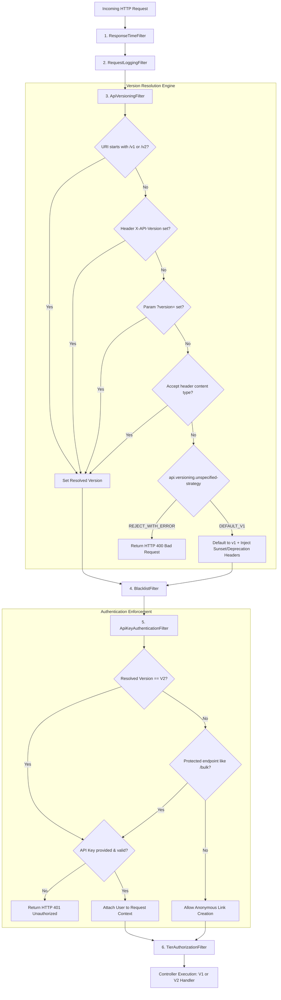

# 📦 VYSONM2A4: API Versioning Architecture & Implementation

> **Branch:** [`feature/m2a4-api-versioning`](https://github.com/AkshayMadan098/Backend-projects/tree/feature/m2a4-api-versioning)  
> **Project:** URL Shortener & Analytics Platform (Milestone 2, Assignment 4)  
> **Tech Stack:** Java 21 (LTS), Spring Boot 3.3.5, Spring Data JPA, Hibernate 6, SQLite 3 (WAL mode), JUnit 5, MockMvc  
> **Test Status:** ✅ **34/34 Automated Tests Passing** (12 Core Tests + 9 Middleware Tests + 13 Versioning Tests)

---

## 📑 Table of Contents

- [💡 Overview: Why API Versioning?](#-overview-why-api-versioning)
- [🏛️ Versioning Architecture & Pipeline](#️-versioning-architecture--pipeline)
- [[Q1] Julian vs. Gregorian Calendar & The "Missing Days"](#q1-julian-vs-gregorian-calendar--the-missing-days)
- [Breaking vs. Non-Breaking Changes Analysis ([Q2] to [Q8])](#breaking-vs-non-breaking-changes-analysis-q2-to-q8)
  - [[Q2] Health Check Endpoint](#q2-health-check-endpoint)
  - [[Q3] Bulk Creation Endpoint](#q3-bulk-creation-endpoint)
  - [[Q4] Multiple Short Codes for Identical URL](#q4-multiple-short-codes-for-identical-url)
  - [[Q5] Custom Short Codes](#q5-custom-short-codes)
  - [[Q6] Edit Requests on Short Codes](#q6-edit-requests-on-short-codes)
  - [[Q7] Password Protection](#q7-password-protection)
  - [[Q8] Re-implementing in a New Language (Preserving Contracts)](#q8-re-implementing-in-a-new-language-preserving-contracts)
- [Industry Versioning Strategies ([Q9] & [Q10])](#industry-versioning-strategies-q9--q10)
  - [[Q9] Twitter (X) API Versioning](#q9-twitter-x-api-versioning)
  - [[Q10] Facebook Graph API & GraphQL Versioning](#q10-facebook-graph-api--graphql-versioning)
- [[Q11] Semantic Versioning & Platform Changelog](#q11-semantic-versioning--platform-changelog)
- [[Q12] Authentication Migration Guide (v1 → v2)](#q12-authentication-migration-guide-v1--v2)
- [[Q13] Postman Collection & API Documentation](#q13-postman-collection--api-documentation)
- [[Q14 BONUS] Unspecified Version Handling: Error vs. Default](#q14-bonus-unspecified-version-handling-error-vs-default)
- [🧪 Automated Test Suite Execution](#-automated-test-suite-execution)
- [📁 Project Source Code Structure](#-project-source-code-structure)

---

## 💡 Overview: Why API Versioning?

> *"Successful software always gets changed."* — Frederick P. Brooks

As a backend platform evolves, new features, bug fixes, and security requirements inevitably alter how endpoints operate. If a published API introduces incompatible modifications (such as mandating authentication or renaming fields), existing client applications in production will crash.

**API Versioning** is the disciplined practice of transparently managing changes to published contracts. It enables service providers to innovate and introduce major security/architectural improvements (API v2) while honoring contracts for legacy clients (API v1) over a predictable deprecation lifecycle.

---

## 🏛️ Versioning Architecture & Pipeline

In this assignment, we engineered a production-grade multi-strategy versioning engine directly into the URL Shortener application:



---

## [Q1] Julian vs. Gregorian Calendar & The "Missing Days"

### Historical Context
Introduced by Julius Caesar in 45 BC, the **Julian Calendar** calculated a solar year as **365.25 days**, adding a leap day every 4 years. However, an astronomical tropical year is approximately **365.24219 days** (roughly 11 minutes and 14 seconds shorter). Over sixteen centuries, this minute discrepancy accumulated into an error of about 1 day every 128 years.

By 1582, the calendar had drifted by **10 full days**, causing the vernal equinox to fall on March 11 rather than March 21. Because the calculation of Easter depends on the vernal equinox, Pope Gregory XIII promulgated the papal bull *Inter gravissimas* introducing the **Gregorian Calendar**.

### The Technical Difference: The Leap Year Rule
The Gregorian Calendar introduced a refinement to century years:
* **Julian Rule:** Every year divisible by 4 is a leap year.
* **Gregorian Rule:** A year is a leap year if divisible by 4, **unless** it is divisible by 100, **in which case it must also be divisible by 400**.
  * Years `1600`, `2000`, `2400` are leap years.
  * Years `1700`, `1800`, `1900`, `2100` are common years (365 days).
* This trimmed the average calendar year to **365.2425 days**, reducing the error to just 1 day in 3,030 years.

### The "Missing Days" in History
To align the calendar with astronomical reality, 10 calendar days were completely eliminated in Catholic countries in October 1582:
* **Thursday, 4 October 1582** was immediately followed by **Friday, 15 October 1582**.
* People went to sleep on October 4 and woke up on October 15! The days October 5 through October 14, 1582 never existed.
* Different nations adopted the Gregorian reform at different times:
  * **Britain & the American Colonies (1752):** Had drifted by 11 days. Wednesday, 2 September 1752 was followed by Thursday, 14 September 1752.
  * **Russia (1918):** Following the Bolshevik revolution, Russia was 13 days out of sync. 31 January 1918 was followed by 14 February 1918.

### Parallels to Software Engineering & API Breaking Changes
The calendar reform is history's greatest real-world example of an **API breaking change**:
1. **Contract Incompatibility:** Systems relying on continuous time arithmetic suffered index offset exceptions.
2. **Data Migration Challenges:** Contracts, interest calculations, rents, and birthdays had to be retroactively recalculated across the 10-day gap.
3. **Phased Deprecation & Distributed Adoption:** Because Protestant and Orthodox nations refused Catholic papal authority initially, Europe ran on two competing, incompatible "API versions" (Old Style vs. New Style) for over 300 years, requiring dual date stamps (`e.g., 10/21 February 1613`) much like maintaining dual version endpoints (`/v1` and `/v2`)!

---

## Breaking vs. Non-Breaking Changes Analysis ([Q2] to [Q8])

A **breaking change** forces consumers to modify their existing client code or fail. A **non-breaking change** is backward compatible, allowing legacy consumers to continue operating without changes.

| Question | Feature Introduced | Change Type | Architectural Justification |
| :--- | :--- | :---: | :--- |
| **[Q2]** | `/health` endpoint checkpoint | 🟢 **Non-Breaking** | Additive change. Introduces a new route (`GET /health`) without altering any existing endpoint contracts or schemas. |
| **[Q3]** | Bulk creation feature (`POST /shorten/bulk`) | 🟢 **Non-Breaking** | Additive change. Existing `/shorten` callers continue to function unaffected; bulk shortening is isolated to a new route. |
| **[Q4]** | Multiple short codes for the same URL | 🟢 **Non-Breaking** | Preserves request/response schema. Existing clients sending URLs still receive a valid short code and redirect continues to function normally. |
| **[Q5]** | Custom short code support (`customCode`) | 🟢 **Non-Breaking** | Optional request field. When omitted, the shortener defaults to random Base62 generation, preserving identical behavior for existing callers. |
| **[Q6]** | Edit requests on short codes (`PUT /shorten/{code}`) | 🟢 **Non-Breaking** | Additive HTTP verb/path. Consumers who only perform shorten and redirect operations are completely unaffected. |
| **[Q7]** | Password protection on short codes | 🟢 **Non-Breaking** | Optional feature. Unprotected links continue to redirect transparently; only links explicitly created with a password challenge the visitor. |
| **[Q8]** | Language rewrite (Java → Go/Rust) keeping contracts | 🟢 **Non-Breaking** | Contract encapsulation. HTTP APIs communicate over language-agnostic wire protocols (HTTP, JSON). If headers, status codes, paths, and payloads remain identical, consumers cannot detect internal runtime changes. |

---

## Industry Versioning Strategies ([Q9] & [Q10])

### [Q9] Twitter (X) API Versioning
Twitter (X) employs **URL Path Versioning** combined with OAuth 2.0 Bearer Token authentication:
* **Current Latest Version:** **Twitter API v2** (`v2.x`).
* **Endpoint Pattern:** `https://api.twitter.com/2/tweets`, `https://api.twitter.com/2/users`.
* **Deprecation Strategy:** Twitter maintains legacy `/1.1` endpoints alongside `/2` under strict deprecation schedules.
* **Granular Query Projections:** Within v2, Twitter uses query parameters to avoid payload bloat without breaking schemas (e.g., `?tweet.fields=created_at,author_id,public_metrics`).

### [Q10] Facebook Graph API & GraphQL Versioning
Facebook utilizes a unique versioning cadence for its Graph API:
* **Current Latest Version:** **Graph API v22.0** (released February 2025).
* **Versioning Pattern:** Explicit URL path prefix: `https://graph.facebook.com/v22.0/{node-id}`.
* **Predictable Lifecycle:** Facebook releases a new minor version **quarterly** (every ~90 days) and guarantees a **2-year lifespan** for each version before sunset.
* **GraphQL Versioning Philosophy:** In pure GraphQL, versioning is traditionally avoided by treating the schema as a continuously evolving graph. Fields are never removed immediately; instead, fields are marked with the `@deprecated(reason: "...")` directive and new fields are added alongside them. However, Facebook's public developer Graph API uses explicit path-based versions (`/v22.0`) to provide firm enterprise stability guarantees.

---

## [Q11] Semantic Versioning & Platform Changelog

We follow [Semantic Versioning 2.0.0](https://semver.org/) (`MAJOR.MINOR.PATCH`):
* **Major (2.0.0):** Breaking changes (Mandated API key authentication, enriched response models, strict versioning).
* **Minor (1.3.0, 1.2.0, 1.1.0):** Backward-compatible feature additions (Middlewares, link expiration, bulk creation).
* **Patch (1.0.1):** Backward-compatible bug fixes.

The platform includes a dedicated, professionally formatted [`CHANGELOG.md`](file:///Users/akshay/url-shortener/CHANGELOG.md) adhering to the [Keep a Changelog](https://keepachangelog.com/) standard.

---

## [Q12] Authentication Migration Guide (v1 → v2)

When transitioning from anonymous link creation (v1) to mandatory API key authentication (v2), consumers require structured guidance to avoid production outages.

We published a comprehensive migration guide: [`MIGRATION_v1_to_v2.md`](file:///Users/akshay/url-shortener/MIGRATION_v1_to_v2.md) covering:
1. Architectural reasons for mandating authentication (abuse mitigation, quota enforcement, ownership).
2. 18-month deprecation timeline with RFC 8594 Sunset headers (`Sunset: Wed, 01 Jun 2027 00:00:00 GMT`).
3. Side-by-side code snippets across **cURL**, **Python**, **JavaScript/Node.js**, and **Java 21**.
4. JSON response schema diffs and error status resolution table.

---

## [Q13] Postman Collection & API Documentation

A complete, production-ready Postman v2.1 collection is available in the repository:
📁 [`postman/vyson_url_shortener_v2.postman_collection.json`](file:///Users/akshay/url-shortener/postman/vyson_url_shortener_v2.postman_collection.json)

### Collection Structure:
1. **V2 Endpoints (Active - Stable):** Authenticated shorten, enterprise bulk, edit, delete, user URLs, and health diagnostics.
2. **V1 Endpoints (Deprecated):** Anonymous shorten with automated test assertions validating RFC 8594 `Deprecation`, `Sunset`, `Warning`, and `Link` headers.
3. **Version Negotiation & Resolution:** Requests validating Header-based (`X-API-Version`), Query-based (`?version=`), and Content Negotiation (`Accept: application/vnd.vyson.v2+json`) routing.
4. **Public Redirection:** `GET /redirect?code={code}` redirect flow assertions.

---

## [Q14 BONUS] Unspecified Version Handling: Error vs. Default

When an API client issues a request to an unversioned URI (e.g. `POST /shorten`) without specifying an API version via URL prefix, header, or query parameter, the backend must decide how to proceed.

### Architectural Comparison of the Two Approaches

```
+----------------------------------------------------------------------------------------------------+
| OPTION 1: Return an Error (HTTP 400 Bad Request / HTTP 422 Unprocessable Entity)                   |
+----------------------------------------------------------------------------------------------------+
| 🟢 Pros:                                                                                           |
|   - Zero Ambiguity: The server never guesses client intent.                                         |
|   - Contract Enforcement: Forces client developers to explicitly decide and lock in their version. |
|   - Prevents Silent Breakage: Clients are never unexpectedly migrated to newer behaviors.          |
| 🔴 Cons:                                                                                           |
|   - Immediate Outage: Existing unversioned legacy clients break instantly upon deployment.          |
|   - Hostile Developer Experience: Breaks the core tenet of backward compatibility.                 |
+----------------------------------------------------------------------------------------------------+

+----------------------------------------------------------------------------------------------------+
| OPTION 2: Default to a Version (e.g. Default to V1 or Default to Latest)                           |
+----------------------------------------------------------------------------------------------------+
| 🟢 Pros:                                                                                           |
|   - Maximum Backward Compatibility: Existing legacy clients continue operating without failure.     |
|   - Smooth Upgrade Funnel: Can inject RFC 8594 Sunset/Deprecation headers informing clients.       |
| 🔴 Cons:                                                                                           |
|   - Hidden Technical Debt: Clients may never migrate if their code continues to work silently.     |
|   - Risk of Confusion: Defaulting to "latest" can silently break consumers when major updates ship. |
+----------------------------------------------------------------------------------------------------+
```

### Our Decision & Justification: The Hybrid Production Pattern
In production systems, **suddenly breaking active paying clients is unacceptable**. Therefore, our implementation adopts the **Hybrid Production Pattern**:

1. **Default Strategy (`DEFAULT_V1`):**
   * Unversioned requests are automatically routed to **API v1**.
   * Legacy integrations continue functioning seamlessly with 100% backward compatibility.
   * Every response is injected with RFC 8594 `Sunset`, `Deprecation`, and RFC 7234 `Warning` headers alerting client developers that they are running on deprecated contracts.
2. **Configurable Strict Mode (`REJECT_WITH_ERROR`):**
   * Governed by `api.versioning.unspecified-strategy=REJECT_WITH_ERROR` in `application.properties`.
   * For enterprise internal microservices where contract ambiguity cannot be tolerated, strict mode immediately returns `HTTP 400 Bad Request` with structured error feedback.

---

## 🧪 Automated Test Suite Execution

The repository features an enterprise-grade automated test suite combining core domain tests, middleware pipeline tests, and comprehensive API versioning tests.

### Running All Tests
```bash
cd url-shortener
./mvnw clean test
```

### Verified Test Suite Breakdown (34 Tests Passing):

| Test Class | Category | Tests | Key Scenarios Validated |
| :--- | :--- | :---: | :--- |
| `UrlShortenerIntegrationTests` | Core Domain | 12 | Base62 generation, 302 redirection, empty URL 400 rejection, click counters, custom codes, link expiration, password protection. |
| `MiddlewareIntegrationTests` | Pipeline Filters | 9 | Request logging to SQLite, route exclusion (`/health`), API key authentication, enterprise bulk authorization, runtime file blacklist, response time profiling. |
| `ApiVersioningIntegrationTests` | Versioning Engine | 13 | URL path versioning (`/v1` vs `/v2`), RFC 8594 Sunset/Deprecation headers, v2 mandatory auth breaking change, Header versioning, Query param versioning, Content Negotiation, Default v1 fallback, Strict mode rejection, V2 diagnostic health, Enterprise bulk v2. |
| **Total** | | **34** | **100% Passing (0 Failures, 0 Errors, 0 Skipped)** |

---

## 📁 Project Source Code Structure

```
url-shortener/
├── src/
│   ├── main/
│   │   ├── java/com/vyson/urlshortener/
│   │   │   ├── config/
│   │   │   │   ├── DataInitializer.java        # Seeds sample users (Alice, Bob, Enterprise)
│   │   │   │   └── FilterConfig.java           # Central middleware filter chaining & ordering
│   │   │   ├── controller/
│   │   │   │   ├── UrlShortenerController.java   # Root controller with dynamic version adaptation
│   │   │   │   ├── UrlShortenerV1Controller.java # Legacy v1 controller (anonymous allowed, deprecated)
│   │   │   │   └── UrlShortenerV2Controller.java # Modern v2 controller (mandatory auth, enriched schema)
│   │   │   ├── dto/
│   │   │   │   ├── ShortenRequest.java
│   │   │   │   ├── ShortenResponse.java          # Flat v1 response DTO
│   │   │   │   ├── ShortenV2Response.java        # Enriched v2 response DTO with owner & metadata
│   │   │   │   ├── ShortenBulkRequest.java
│   │   │   │   └── ShortenBulkV2Response.java
│   │   │   ├── filter/
│   │   │   │   ├── FilterOrderConstants.java     # Chaining order constants (Order 1 to 6)
│   │   │   │   ├── MiddlewareConstants.java      # Context attributes & HTTP header keys
│   │   │   │   ├── ResponseTimeFilter.java       # Order 1: X-Response-Time profiler
│   │   │   │   ├── RequestLoggingFilter.java     # Order 2: SQLite request logger
│   │   │   │   ├── BlacklistFilter.java          # Order 4: Runtime file blacklist filter
│   │   │   │   ├── ApiKeyAuthenticationFilter.java# Order 5: API key auth & v2 breaking gate
│   │   │   │   └── TierAuthorizationFilter.java  # Order 6: Enterprise tier validator
│   │   │   ├── versioning/
│   │   │   │   ├── ApiVersion.java               # Enum: V1, V2, UNSPECIFIED
│   │   │   │   ├── ApiVersioningProperties.java  # Configuration: UnspecifiedStrategy, Sunset dates
│   │   │   │   ├── ApiVersionResolver.java       # Path, Header, Query, Accept resolver
│   │   │   │   └── ApiVersioningFilter.java      # Order 3: Version resolution & RFC 8594 headers
│   │   │   └── service/
│   │   │       ├── UrlShortenerService.java      # Core business service with v1 & v2 builders
│   │   │       └── BlacklistService.java
│   │   └── resources/
│   │       └── application.properties           # SQLite, Hikari, Logging, and Versioning settings
│   └── test/
│       └── java/com/vyson/urlshortener/
│           ├── UrlShortenerIntegrationTests.java # 12 core domain tests
│           ├── MiddlewareIntegrationTests.java   # 9 middleware tests
│           └── ApiVersioningIntegrationTests.java# 13 API versioning tests
├── postman/
│   └── vyson_url_shortener_v2.postman_collection.json # Complete Postman v2.1 collection
├── CHANGELOG.md                                 # SemVer 2.0.0 changelog (v1.0.0 to v2.0.0)
├── MIGRATION_v1_to_v2.md                        # Developer migration guide
└── pom.xml
```
