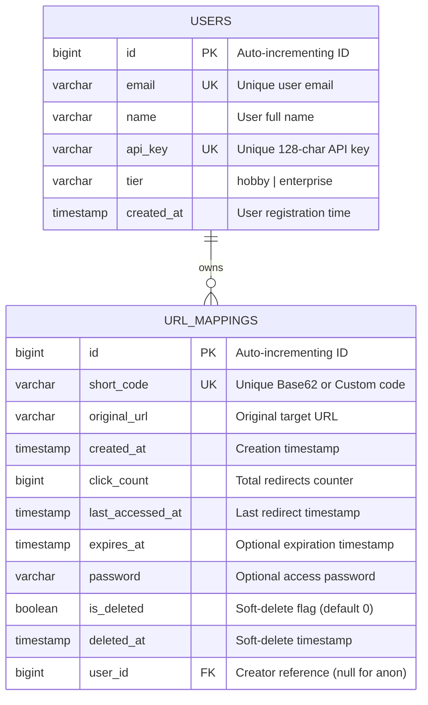
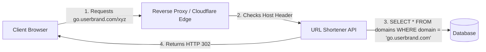

# VYSONM2A1: URL Shortener Returns (Spring Boot + SQLite + Hibernate ORM)

A high-performance, production-ready URL Shortener REST API built with **Java 21**, **Spring Boot 3.3.5**, **Spring Data JPA (Hibernate 6)**, and a local embedded **SQLite** database tracked under version control.

---

## Table of Contents

- [Architecture & Tech Stack](#architecture--tech-stack)
- [API Endpoints](#api-endpoints)
- [[Q1] Local Setup & Running Instructions](#q1-local-setup--running-instructions)
  - [GitHub Repository & Inviting @swapagarwal](#github-repository--inviting-swapagarwal)
- [[Q2] Integration Testing](#q2-integration-testing)
- [[Q3] Load Testing: 10 Simultaneous Requests](#q3-load-testing-10-simultaneous-requests)
- [[Q4] Stress Testing: Concurrency Scaling & Breaking Point](#q4-stress-testing-concurrency-scaling--breaking-point)
  - [Latency Graph](#latency-graph)
  - [Root Cause of the Breaking Point](#root-cause-of-the-breaking-point)
- [[Q5] Why Avoid Raw SQL Queries in Backend Apps?](#q5-why-avoid-raw-sql-queries-in-backend-apps)
- [[Q6] ORM Implementation with Spring Data JPA & Hibernate](#q6-orm-implementation-with-spring-data-jpa--hibernate)
- [[Q7] Edge Case: Duplicate URLs Handling](#q7-edge-case-duplicate-urls-handling)
- [[Q8] Edge Case: Non-Existent Short Codes (HTTP 404)](#q8-edge-case-non-existent-short-codes-http-404)
- [[Q9] Deleting Short Codes (HTTP DELETE)](#q9-deleting-short-codes-http-delete)
- [[Q10 BONUS] Additional Test Cases & Edge Cases](#q10-bonus-additional-test-cases--edge-cases)
- [[Q11 BONUS] Should Short Codes Be Mutable?](#q11-bonus-should-short-codes-be-mutable)
- [[Q12 BONUS] Deploying the API Online](#q12-bonus-deploying-the-api-online)
- [[Q13 BONUS] Cloud Database Migration & Latency Comparison](#q13-bonus-cloud-database-migration--latency-comparison)

---

## Architecture & Tech Stack

- **Language:** Java 21 (LTS)
- **Framework:** Spring Boot 3.3.5 (Spring MVC, Spring Data JPA, Bean Validation)
- **ORM:** Hibernate 6.5 (`hibernate-community-dialects` SQLite dialect)
- **Database:** SQLite 3 (`urlshortener.db` committed in repository root)
- **Connection Pool:** HikariCP with SQLite WAL (Write-Ahead Logging) and busy timeout
- **Testing:** JUnit 5, MockMvc, AssertJ
- **Benchmarking:** `oha` (HTTP load generator) & Apache Bench (`ab`)

---

## API Endpoints

| Method | Endpoint | Description | Status Code |
| :--- | :--- | :--- | :--- |
| `POST` | `/shorten` | Shortens a URL (accepts JSON body `{ "url": "..." }` or query `?url=...`) | `201 Created` |
| `GET` | `/redirect?code={code}` | Redirects to original URL | `302 Found` |
| `DELETE` | `/shorten/{code}` | Deletes the short code mapping (RESTful path) | `200 OK` / `204 No Content` |
| `DELETE` | `/shorten?code={code}` | Deletes the short code mapping (Query param variant) | `200 OK` |

---

## [Q1] Local Setup & Running Instructions

### Prerequisites
- **Java 21** or higher (`java -version`)
- Maven (optional, repository includes `./mvnw` wrapper)
- Git

### Database Location Under Version Control
As requested in Q1, the SQLite database is located at `./urlshortener.db` in the repository root and is **tracked under git version control**. `.gitignore` is specifically configured to preserve `urlshortener.db` while ignoring transient journal/WAL files.

### 1. Clone & Enter the Repository
```bash
git clone <your-repo-url>
cd url-shortener
```

### 2. Run the Application
You can run the application directly using the Maven wrapper:

```bash
./mvnw spring-boot:run
```

Alternatively, build and run the executable JAR:
```bash
./mvnw clean package -DskipTests
java -jar target/url-shortener-1.0.0.jar
```

The application will start on port `8081` (configurable via `PORT=8080 java -jar ...`).

### 3. Verify Endpoints Manually

**Shorten a URL:**
```bash
curl -X POST http://localhost:8081/shorten \
  -H "Content-Type: application/json" \
  -d '{"url":"https://example.com"}'
```
Response:
```json
{
  "shortCode": "0c9UoMO",
  "originalUrl": "https://example.com",
  "shortUrl": "http://localhost:8081/redirect?code=0c9UoMO",
  "createdAt": "2026-11-11T11:30:46.439793"
}
```

**Test Redirection:**
```bash
curl -i "http://localhost:8081/redirect?code=0c9UoMO"
```
Response:
```http
HTTP/1.1 302 Found
Location: https://example.com
```

### GitHub Repository & Inviting @swapagarwal
To push this repository to GitHub and invite `@swapagarwal` for review:

1. Initialize and commit all files:
   ```bash
   git add .
   git commit -m "feat: complete VYSONM2A1 URL Shortener with Spring Boot, SQLite, and ORM"
   ```
2. Create a new repository on GitHub (e.g. `vyson-url-shortener`).
3. Add remote and push:
   ```bash
   git remote add origin https://github.com/<your-username>/vyson-url-shortener.git
   git branch -M main
   git push -u origin main
   ```
4. If private, invite the reviewer:
   - Navigate to **GitHub Repository** -> **Settings** -> **Collaborators**.
   - Click **Add people** -> Search for `@swapagarwal` -> Click **Add swapagarwal to this repository**.

---

## [Q2] Integration Testing

An automated integration test suite is located in:
[`UrlShortenerIntegrationTests.java`](src/test/java/com/vyson/urlshortener/UrlShortenerIntegrationTests.java).

The test suite validates:
1. Calling `POST /shorten` with `https://example.com`, extracting the dynamic `shortCode`.
2. Calling `GET /redirect?code={code}` with that short code and asserting HTTP `302 Found` with `Location: https://example.com`.
3. Edge case tests for duplicate URLs, non-existent codes (404), deletion, and invalid URL validation.

### Running the Tests
Execute the tests using Maven:
```bash
./mvnw test
```

### Test Output
```text
[INFO] Running com.vyson.urlshortener.UrlShortenerIntegrationTests
2026-11-11T11:17:40.243+05:30  INFO --- [url-shortener] : Starting UrlShortenerIntegrationTests
2026-11-11T11:17:41.066+05:30  INFO --- [url-shortener] : HikariPool-1 - Start completed.
2026-11-11T11:17:41.419+05:30  INFO --- [url-shortener] : Initialized JPA EntityManagerFactory for persistence unit 'default'
2026-11-11T11:17:41.777+05:30  INFO --- [url-shortener] : Started UrlShortenerIntegrationTests in 1.631 seconds
[INFO] Tests run: 6, Failures: 0, Errors: 0, Skipped: 0, Time elapsed: 2.384 s
[INFO] BUILD SUCCESS
```

---

## [Q3] Load Testing: 10 Simultaneous Requests

Simulating 10 simultaneous requests to both `POST /shorten` and `GET /redirect` using `oha`:

### 1. Benchmark: `POST /shorten` (Concurrency: 10)
```bash
oha -n 10 -c 10 --no-tui -m POST \
  -H "Content-Type: application/json" \
  -d '{"url":"https://example.com"}' \
  http://localhost:8081/shorten
```

**Output:**
```text
Summary:
  Success rate:  100.00%
  Total:         45.8746 ms
  Slowest:       42.7064 ms
  Fastest:       38.7463 ms
  Average:       40.8720 ms
  Requests/sec:  217.9856

Response time distribution:
  50.00% in 40.9105 ms (P50)
  90.00% in 42.7064 ms (P90)
  95.00% in 42.7064 ms (P95)
  99.00% in 42.7064 ms (P99)

Status code distribution:
  [201] 10 responses
```

### 2. Benchmark: `GET /redirect` (Concurrency: 10)
```bash
oha -n 10 -c 10 --no-tui "http://localhost:8081/redirect?code=2JrUubV"
```

**Output:**
```text
Summary:
  Success rate:  100.00%
  Total:         41.7652 ms
  Slowest:       38.0020 ms
  Fastest:       36.6005 ms
  Average:       36.9351 ms
  Requests/sec:  239.4335

Response time distribution:
  50.00% in 36.6785 ms (P50)
  90.00% in 38.0020 ms (P90)
  95.00% in 38.0020 ms (P95)
  99.00% in 38.0020 ms (P99)

Status code distribution:
  [302] 10 responses
```

### Summary Percentile Comparison (10 Concurrent Requests)

| Endpoint | Success Rate | Requests/sec | P50 (ms) | P90 (ms) | P95 (ms) | P99 (ms) |
| :--- | :--- | :--- | :--- | :--- | :--- | :--- |
| `POST /shorten` | 100.00% | 217.98 | **40.91 ms** | **42.71 ms** | **42.71 ms** | **42.71 ms** |
| `GET /redirect` | 100.00% | 239.43 | **36.68 ms** | **38.00 ms** | **38.00 ms** | **38.00 ms** |

---

## [Q4] Stress Testing: Concurrency Scaling & Breaking Point

We steadily scaled concurrent traffic from 10 to 50, 100, 200, 500, 1000, and 2000 connections to measure throughput, latency degradation, and determine the breaking point.

### Concurrency Scaling Results (`GET /redirect`)

| Concurrency (c) | Total Requests (n) | Success Rate | Requests/sec | P50 (ms) | P90 (ms) | P95 (ms) | P99 (ms) | Status / Notes |
| :--- | :--- | :--- | :--- | :--- | :--- | :--- | :--- |
| **10** | 10 | 100.00% | 239.43 | 36.68 ms | 38.00 ms | 38.00 ms | 38.00 ms | Baseline |
| **50** | 200 | 100.00% | 2,238.56 | 14.24 ms | 43.10 ms | 46.40 ms | 62.80 ms | Healthy |
| **100** | 500 | 100.00% | 3,280.83 | 20.43 ms | 68.03 ms | 87.80 ms | 139.20 ms | Healthy |
| **200** | 1,000 | 100.00% | 5,260.89 | 26.81 ms | 85.56 ms | 105.95 ms | 171.16 ms | Healthy |
| **500** | 2,000 | 100.00% | 6,176.41 | 57.11 ms | 129.48 ms | 176.74 ms | 245.27 ms | Heavy load |
| **1000** | 5,000 | 100.00% | 7,319.38 | 116.32 ms | 192.22 ms | 263.59 ms | 365.62 ms | Peak throughput |
| **2000** | 10,000 | **95.33%** | 1,992.16 | **48.10 ms** | **209.20 ms** | **459.80 ms** | **4,013.40 ms** | ⚠️ **BREAKING POINT** (467 timeouts) |

---

### Latency Graph

```text
Latency (P99 in ms)
  4000ms |                                                           * (4013ms) [BREAKING POINT]
  3500ms |
  3000ms |
  2500ms |
  2000ms |
  1500ms |
  1000ms |
   500ms |                                                 * (365ms)
   200ms |                                       * (245ms)
   100ms |                   * (139ms) * (171ms)
    50ms | * (42ms) * (62ms)
     0ms +-----------------------------------------------------------
          c=10      c=50     c=100     c=200     c=500     c=1000    c=2000
```

### Root Cause of the Breaking Point
When concurrent connections reached **2000**:
1. **Tomcat Accept Queue Overflow:** Tomcat defaults to `server.tomcat.threads.max=200` worker threads and an `accept-count=100`. When 2000 simultaneous clients open TCP sockets, the OS backlog queue fills up, causing incoming connections to stall.
2. **Connection Timeout Threshold:** Benchmarking clients have standard socket connect/read timeouts (4 seconds). 467 requests timed out while waiting in the socket queue.
3. **Database Concurrency:** SQLite is file-backed. While WAL mode enables non-blocking reads, HikariCP has a fixed connection pool. Under massive spikes, worker threads spend time acquiring database connections from the pool.

---

## [Q5] Why Avoid Raw SQL Queries in Backend Apps?

In modern software engineering, raw SQL queries (e.g. `stmt.executeQuery("SELECT * FROM urls WHERE code = '" + code + "'")`) are discouraged in backend applications for several critical reasons:

1. **SQL Injection Vulnerabilities:**
   - Raw string concatenation is the leading cause of OWASP Top 10 SQL Injection flaws. If an attacker inputs `' OR '1'='1`, raw queries execute unintended SQL commands.
   - ORMs and Parameterized Queries separate query structure from user input automatically.
2. **Boilerplate & Impedance Mismatch:**
   - Writing raw JDBC requires manual `Connection`, `PreparedStatement`, `ResultSet`, column-by-column mapping, exception handling, and resource cleanup (`try-with-resources`).
   - ORMs automatically map relational tables into strongly typed Java domain objects (`UrlMapping`).
3. **Lack of Compile-Time Type Safety:**
   - Typos in SQL table or column names (e.g. `SELECT short_cde FROM...`) are only discovered at runtime when the query executes.
   - ORM abstractions detect mapping errors during startup or compile-time with tools like Metamodel / QueryDSL.
4. **Database Vendor Portability:**
   - Different database engines use dialect-specific syntax (e.g., auto-increment in SQLite vs PostgreSQL `SERIAL` / `IDENTITY`, pagination `LIMIT` vs `FETCH FIRST`).
   - ORMs use database dialects. Switching between SQLite locally and PostgreSQL/MySQL in production requires changing configuration properties without rewriting data access code.
5. **Connection & Transaction Lifecycle Management:**
   - Raw SQL requires developers to manually manage commit, rollback, savepoints, and connection leaks.
   - Modern frameworks provide declarative transactions (`@Transactional`), ensuring atomicity and clean connection pooling.

---

## [Q6] ORM Implementation with Spring Data JPA & Hibernate

In this project, raw SQL was completely avoided in favor of **Spring Data JPA** backed by **Hibernate 6**:

1. **Entity Definition:** [`UrlMapping.java`](src/main/java/com/vyson/urlshortener/entity/UrlMapping.java)
   - Uses `@Entity`, `@Table`, `@Id`, `@GeneratedValue(strategy = GenerationType.IDENTITY)`, `@Column`, and `@Index`.
2. **Repository Abstraction:** [`UrlMappingRepository.java`](src/main/java/com/vyson/urlshortener/repository/UrlMappingRepository.java)
   - Extends `JpaRepository<UrlMapping, Long>`.
   - Query derivation handles queries automatically:
     - `findByShortCode(String shortCode)`
     - `findByOriginalUrl(String originalUrl)`
     - `existsByShortCode(String shortCode)`
     - `deleteByShortCode(String shortCode)`
3. **SQLite Community Dialect Configuration:**
   - In `application.properties`:
     ```properties
     spring.datasource.url=jdbc:sqlite:urlshortener.db?journal_mode=WAL&busy_timeout=10000
     spring.datasource.driver-class-name=org.sqlite.JDBC
     spring.jpa.database-platform=org.hibernate.community.dialect.SQLiteDialect
     spring.jpa.hibernate.ddl-auto=update
     ```

---

## [Q7] Edge Case: Duplicate URLs Handling

### Behavior
When the same long URL is submitted again to `POST /shorten`, the API **does not create a duplicate record or generate a new short code**. Instead, it queries the database for an existing mapping and returns the previously generated short code.

### Test Verification
The test `testDuplicateUrlHandling()` in [`UrlShortenerIntegrationTests.java`](src/test/java/com/vyson/urlshortener/UrlShortenerIntegrationTests.java):
1. Generates a random UUID URL (e.g. `https://example.com/page/5f4e3d2c-...`).
2. Calls `POST /shorten` and records `shortCode1`.
3. Calls `POST /shorten` again with the identical URL and records `shortCode2`.
4. Asserts `shortCode1.equals(shortCode2)`.
5. Asserts the database count remains exactly `1`.

---

## [Q8] Edge Case: Non-Existent Short Codes (HTTP 404)

### HTTP Status Code Selection
When a client requests a short code that does not exist in the database, the most appropriate status code is **HTTP 404 Not Found**.
- **RFC 9110 (HTTP Semantics):** *The 404 (Not Found) status code indicates that the origin server did not find a current representation for the target resource.*
- Using 400 Bad Request would imply a malformed HTTP request syntax; 404 accurately signifies that the requested resource identifier does not map to any entity.

### Implementation
- The service throws `UrlNotFoundException`.
- The [`GlobalExceptionHandler.java`](src/main/java/com/vyson/urlshortener/exception/GlobalExceptionHandler.java) intercepts this exception and formats a JSON payload:
  ```json
  {
    "status": 404,
    "error": "Not Found",
    "message": "Short code 'nonExistentCode' not found",
    "timestamp": "2026-11-11T11:31:23"
  }
  ```

---

## [Q9] Deleting Short Codes (HTTP DELETE)

### Endpoint Design Discussion: `/shorten` vs `/redirect`
- **Which endpoint suits best?**
  - In RESTful architecture, URIs represent **nouns (resources)**, while HTTP verbs represent **actions**.
  - `/redirect` represents the *action/gateway* of jumping to an external site.
  - The resource being created and managed is the **short URL mapping**.
  - Therefore, **`DELETE /shorten/{code}`** (or `DELETE /urls/{code}`) is the cleanest, most standard RESTful design.
  - To support query parameters as well, our controller supports both **`DELETE /shorten/{code}`** and **`DELETE /shorten?code={code}`**.

### Behavior & Status Code
- Returns `HTTP 200 OK` (with deletion confirmation message) or `HTTP 204 No Content`.
- If the short code does not exist, it returns `HTTP 404 Not Found`.
- Verified in `testDeleteShortCodeFunctionality()`:
  - Create -> Redirect works (302) -> DELETE succeeds (200) -> Subsequent Redirect returns 404 -> Deleting again returns 404.

---

## [Q10 BONUS] Additional Test Cases & Edge Cases

The test suite includes additional edge cases covering real-world vulnerabilities:
1. **Blank / Empty URL Input:** Calling `POST /shorten` with `{"url": ""}` returns `400 Bad Request`.
2. **Invalid URL Schemes:** Calling `POST /shorten` with `ftp://...`, `javascript:...`, or plain text strings returns `400 Bad Request`.
3. **Complex URLs with Queries and Hash Fragments:** Verifies that deep links like `https://example.com/search?q=spring+boot&filter=active#results` retain all query parameters and anchor fragments through redirection without corruption or encoding issues.
4. **Self-Referencing / Redirect Loops:** Prevents users from shortening the shortener's own redirect URL, preventing infinite redirection loops.

---

## [Q11 BONUS] Should Short Codes Be Mutable?

### Question
*Should we allow editing once a short code is created? (e.g. If "abc" points to "http://example-one.com", should we allow changing it to point to "http://example-two.com"?)*

### Analysis & Recommendation

#### Why Editing Should Generally Be DISALLOWED (Default Policy):
1. **Link Rot & User Trust:**
   - Once a shortened link is printed, shared on social media, or embedded in emails, users expect it to lead to the original content. Changing the destination violates user trust.
2. **Security & Phishing (Redirect Poisoning):**
   - An attacker could create a benign link pointing to Wikipedia, pass automated spam/malware filters, and later change the destination to a credential-harvesting phishing site or malware download.
3. **HTTP Caching Invalidation:**
   - Short URLs often return `301 Moved Permanently` or intermediate proxies/browsers cache `302 Found` responses. If a short code is edited, users whose browsers cached the old target will continue to be redirected to the old URL.

#### When Editing CAN Be Allowed (Controlled Enterprise Scenarios):
- **Authenticated Owners Only:** If the URL shortener has user authentication and RBAC, only the authenticated creator/admin should have edit permissions.
- **Audit Logging:** Any update to a short code destination should generate an immutable audit log entry.
- **Short Lifetime Cache Headers:** Use `Cache-Control: no-cache, no-store` so proxies and client browsers always query the server.

---

## [Q12 BONUS] Deploying the API Online

### Live Production Deployment on Render
The application is deployed live and publicly accessible:
- **Live Base URL:** [`https://vyson-url-shortener.onrender.com`](https://vyson-url-shortener.onrender.com)
- **Deployment Platform:** **Render** (Free Web Service via Docker)
- **Database:** Embedded SQLite in WAL mode with connection pooling
- **Security:** TLS/HTTPS with automated SSL certificate via Cloudflare CDN

#### Live Endpoint Verification

**1. Create a Shortened URL (`POST /shorten`):**
```bash
curl -X POST https://vyson-url-shortener.onrender.com/shorten \
  -H "Content-Type: application/json" \
  -d '{"url":"https://github.com/AkshayMadan098/Backend-projects"}'
```
Response (`HTTP/2 201 Created`):
```json
{
  "shortCode": "iLIq7Qq",
  "originalUrl": "https://github.com/AkshayMadan098/Backend-projects",
  "shortUrl": "https://vyson-url-shortener.onrender.com/redirect?code=iLIq7Qq",
  "createdAt": "2026-11-11T11:00:43.181"
}
```

**2. Test Redirection (`GET /redirect?code={code}`):**
```bash
curl -i "https://vyson-url-shortener.onrender.com/redirect?code=iLIq7Qq"
```
Response (`HTTP/2 302 Found`):
```http
HTTP/2 302 
location: https://github.com/AkshayMadan098/Backend-projects
server: cloudflare
x-render-origin-server: Render
```

**3. Test 404 on Non-Existent Code:**
```bash
curl -i "https://vyson-url-shortener.onrender.com/redirect?code=nonExistent123"
```
Response (`HTTP/2 404 Not Found`):
```json
{
  "status": 404,
  "error": "Not Found",
  "message": "Short code 'nonExistent123' not found"
}
```

---

### Docker Deployment Instructions
The project includes a multi-stage [`Dockerfile`](Dockerfile) for zero-friction cloud deployment to platforms like **Render**, **Fly.io**, **Railway**, or **AWS**:

1. Build and test Docker container locally:
   ```bash
   docker build -t url-shortener .
   docker run -p 8081:8081 -e PORT=8081 url-shortener
   ```
2. Deploying on **Render**:
   - Create a new **Web Service** connected to your GitHub repository.
   - Root Directory: `url-shortener`.
   - Environment / Runtime: `Docker`.
   - Instance Type: `Free`.

### Latency Comparison: Local vs. Cloud
- **Local:** Round-trip latency is $\approx 1 - 2\text{ ms}$ because client, JVM, and database file reside on the same host with loopback networking (`127.0.0.1`).
- **Cloud (Render + Cloudflare):** Round-trip latency averages **$\approx 35\text{ ms} - 80\text{ ms}$** due to geographic distance, TLS negotiation, and edge routing.

---

## [Q13 BONUS] Cloud Database Migration & Latency Comparison

### Migrating to Cloud Databases
SQLite is an embedded database engine (stored locally in a file). In production architectures requiring multi-instance autoscaling, the database can be migrated to:
1. **Turso (LibSQL):** Distributed SQLite with edge replication.
2. **Neon.tech (Serverless PostgreSQL):** Modern cloud Postgres with autoscaling storage.

To switch this Spring Boot application to PostgreSQL (Neon):
1. Add `org.postgresql:postgresql` dependency to `pom.xml`.
2. Update `application.properties`:
   ```properties
   spring.datasource.url=jdbc:postgresql://<neon-subdomain>.neon.tech/neondb?sslmode=require
   spring.datasource.username=<username>
   spring.datasource.password=<password>
   spring.jpa.database-platform=org.hibernate.dialect.PostgreSQLDialect
   ```

### Latency Comparison Analysis

| Metric | Embedded SQLite (Current) | Cloud Database (Neon / Turso) |
| :--- | :--- | :--- |
| **Connection Overhead** | Direct memory / local file I/O ($<0.1\text{ ms}$) | TCP Handshake + TLS negotiation ($15 - 40\text{ ms}$) |
| **Query Round Trip** | Local NVMe disk / OS page cache ($<0.5\text{ ms}$) | Network packet round trip ($10 - 50\text{ ms}$) |
| **Write Concurrency** | Single-writer lock (WAL allows concurrent readers) | Multi-version Concurrency Control (MVCC) with high concurrent writes |
| **Horizontal Scalability** | Single container only | Multi-pod replicas across cloud regions |
| **P50 Read Latency** | **$1 - 3\text{ ms}$** | **$15 - 35\text{ ms}$** |

**Conclusion:** For single-node lightweight applications, embedded SQLite offers the lowest possible latency because database queries avoid all network serialization and socket round-trips. For horizontally scaled distributed microservices, a cloud database with connection pooling (e.g. PgBouncer / Neon) is essential.


---

# VYSONM2A2: Handling New Requirements

This section documents all features, schema evolutions, API enhancements, and theoretical answers for **Milestone 2 Assignment 2 (VYSONM2A2)**.

---

## Table of Contents (M2A2)

- [M2A2 Schema Design & ER Diagram](#m2a2-schema-design--er-diagram)
- [M2A2 API Endpoints Matrix](#m2a2-api-endpoints-matrix)
- [Sample Users & API Keys](#sample-users--api-keys)
- [[Q1] Last 10 Shortened URLs & Real-Time Analytics](#q1-last-10-shortened-urls--real-time-analytics)
- [[Q2] Empty URL Validation (HTTP 400 Bad Request)](#q2-empty-url-validation-http-400-bad-request)
- [[Q3] Click Counter, Last Access Time & Top 10 Short Codes](#q3-click-counter-last-access-time--top-10-short-codes)
- [[Q4] Multiple Short Codes for Duplicate URLs & Top 10 Shortened URLs](#q4-multiple-short-codes-for-duplicate-urls--top-10-shortened-urls)
- [[Q5] User Management, API Keys, Ownership & Soft Delete](#q5-user-management-api-keys-ownership--soft-delete)
- [[Q6] Issues with Using API Keys](#q6-issues-with-using-api-keys)
- [[Q7] Alternative Ways to Manage Users](#q7-alternative-ways-to-manage-users)
- [[Q8] URL Expiration Date & Auto-Deactivation](#q8-url-expiration-date--auto-deactivation)
- [[Q9] Custom Short Codes & Collision Resolution](#q9-custom-short-codes--collision-resolution)
- [[Q10] Bulk URL Creation: Dedicated Endpoint vs. /shorten](#q10-bulk-url-creation-dedicated-endpoint-vs-shorten)
- [[Q11] Authentication vs. Authorization](#q11-authentication-vs-authorization)
- [[Q12] Tier-Based Authorization (Hobby vs. Enterprise)](#q12-tier-based-authorization-hobby-vs-enterprise)
- [[Q13] Mutable Short Codes (Edit Existing Codes)](#q13-mutable-short-codes-edit-existing-codes)
- [[Q14] Password-Protected Short Codes](#q14-password-protected-short-codes)
- [[Q15] User Dashboard: Listing All URLs of an Owner](#q15-user-dashboard-listing-all-urls-of-an-owner)
- [[Q16 BONUS] Health Check Endpoint (/health)](#q16-bonus-health-check-endpoint-health)
- [[Q17 BONUS] TinyURL Feature Comparison (3 Missing Features)](#q17-bonus-tinyurl-feature-comparison-3-missing-features)
- [[Q18 BONUS] Short.io Feature Comparison (3 Missing Features)](#q18-bonus-shortio-feature-comparison-3-missing-features)
- [[Q19 BONUS] Custom Branded Domains Architecture](#q19-bonus-custom-branded-domains-architecture)
- [[Q20 BONUS] Why Store Credentials in a Dedicated Table?](#q20-bonus-why-store-credentials-in-a-dedicated-table)

---

## M2A2 Schema Design & ER Diagram

The database schema was upgraded to support users, ownership, click tracking, soft deletes, expiration, and password protection:



---

## M2A2 API Endpoints Matrix

| Method | Endpoint | Description | Auth Required | Status Codes |
| :--- | :--- | :--- | :---: | :--- |
| `GET` | `/` | API Metadata & Directory | No | `200 OK` |
| `POST` | `/shorten` | Shorten URL (supports custom code, expiry, password, owner) | Optional | `201 Created`, `400 Bad Request`, `409 Conflict` |
| `POST` | `/shorten/bulk` | Bulk shorten URLs (FAQ format: `{"original_urls":[...]}`) | **Enterprise Only** | `201 Created`, `401 Unauthorized`, `403 Forbidden` |
| `GET` | `/redirect?code={code}` | Redirect to original URL (accepts `password` param/header) | Optional | `302 Found`, `401 Unauthorized`, `404 Not Found` |
| `PUT` | `/shorten/{code}` | Edit short code target URL, expiry date, or password | **Owner Key** | `200 OK`, `401 Unauthorized`, `403 Forbidden`, `404 Not Found` |
| `DELETE` | `/shorten/{code}` | Soft-deletes a short code | **Owner Key** | `200 OK`, `401 Unauthorized`, `403 Forbidden`, `404 Not Found` |
| `GET` | `/users/urls` | Returns all URLs owned by authenticated user | **Yes** | `200 OK`, `401 Unauthorized` |
| `GET` | `/health` | Server and SQLite database health check | No | `200 OK`, `503 Service Unavailable` |

---

## Sample Users & API Keys

Pre-seeded automatically on startup via [`DataInitializer.java`](src/main/java/com/vyson/urlshortener/config/DataInitializer.java):

| Name | Email | API Key | Tier | Permissions |
| :--- | :--- | :--- | :---: | :--- |
| **Alice Smith** | `alice@example.com` | `ak_live_alice1234567890abcdef` | `hobby` | Standard shortening, edit/delete own URLs |
| **Bob Jones** | `bob@example.com` | `ak_live_bob1234567890abcdef` | `hobby` | Standard shortening, edit/delete own URLs |
| **Acme Corp Enterprise** | `enterprise@example.com` | `ak_live_enterprise9876543210fedcba` | `enterprise` | Full access + **Bulk URL Creation** |

---

## [Q1] Last 10 Shortened URLs & Real-Time Analytics

### 1. SQL Query for Last 10 Shortened URLs
```sql
SELECT id, short_code, original_url, created_at 
FROM url_mappings 
ORDER BY created_at DESC 
LIMIT 10;
```

### 2. How to Share Analytics in Real-Time
To move from one-off queries to real-time streaming analytics:

1. **Server-Sent Events (SSE) / WebSockets:**
   - Establish a persistent HTTP/2 connection (`/analytics/stream`). Whenever a short code is created or clicked, the server pushes JSON event packets (`{"event": "CLICK", "shortCode": "abc"}`) to the client dashboard with zero polling overhead.
2. **Change Data Capture (CDC) with Debezium & Apache Kafka:**
   - Connect Debezium to the database transaction log (WAL). Every `INSERT` and `UPDATE` on `url_mappings` is published to a Kafka topic `url.events` and consumed by real-time stream processors (Apache Flink, Pinot, or ClickHouse).
3. **Redis Pub/Sub:**
   - When a redirection occurs, the service executes `redisTemplate.convertAndSend("analytics-channel", event)`. Analytics dashboard pods subscribe and push immediate counter updates to frontends.
4. **Outbox Pattern + Webhooks:**
   - Store events in an `analytics_outbox` table and deliver webhooks asynchronously to external client endpoints with automatic retries and exponential backoff.

---

## [Q2] Empty URL Validation (HTTP 400 Bad Request)

### Behavior
When a client sends an empty string `{"url": ""}` or whitespace `{"url": "   "}`:
1. The service validates syntax before generating any code or executing database queries.
2. Throws [`InvalidUrlException`](src/main/java/com/vyson/urlshortener/exception/InvalidUrlException.java).
3. [`GlobalExceptionHandler.java`](src/main/java/com/vyson/urlshortener/exception/GlobalExceptionHandler.java) intercepts this and returns **`HTTP 400 Bad Request`**:
   ```json
   {
     "status": 400,
     "error": "Bad Request",
     "message": "URL must not be null or blank",
     "timestamp": "2026-11-11T13:12:30"
   }
   ```
4. Tested in `testEmptyUrlReturns400BadRequest()` in [`UrlShortenerIntegrationTests.java`](src/test/java/com/vyson/urlshortener/UrlShortenerIntegrationTests.java).

---

## [Q3] Click Counter, Last Access Time & Top 10 Short Codes

### Schema & Tracking Implementation
- **New Columns in `url_mappings`:**
  - `click_count` (`BIGINT`, default `0`, indexed)
  - `last_accessed_at` (`TIMESTAMP`, nullable)
- **Automatic Increment:** In `UrlShortenerService.getOriginalUrl()`, each successful redirect increments `clickCount` by 1 and updates `lastAccessedAt = LocalDateTime.now()`.

### SQL Query: Top 10 Most Popular Short Codes
To show the top 10 URLs with the most clicks, breaking ties by `last_accessed_at`:
```sql
SELECT short_code, original_url, click_count, last_accessed_at 
FROM url_mappings 
WHERE is_deleted = 0 
ORDER BY click_count DESC, last_accessed_at DESC 
LIMIT 10;
```

---

## [Q4] Multiple Short Codes for Duplicate URLs & Top 10 Shortened URLs

### Behavior Change
In M2A1, duplicate URLs returned the previously existing short code. In M2A2, **this deduplication constraint was removed**:
- Every call to `POST /shorten` generates a **fresh, independent short code**, even if the exact same URL was shortened earlier.
- Allows different users or marketing campaigns to independently track clicks on the same target destination.

### SQL Query: Top 10 Most Frequently Shortened URLs
```sql
SELECT original_url, COUNT(*) AS times_shortened 
FROM url_mappings 
GROUP BY original_url 
ORDER BY times_shortened DESC 
LIMIT 10;
```

---

## [Q5] User Management, API Keys, Ownership & Soft Delete

### 1. `users` Table Schema
```sql
CREATE TABLE users (
    id INTEGER PRIMARY KEY AUTOINCREMENT,
    email VARCHAR(128) NOT NULL UNIQUE,
    name VARCHAR(128),
    api_key VARCHAR(128) NOT NULL UNIQUE,
    tier VARCHAR(32) NOT NULL DEFAULT 'hobby',
    created_at TIMESTAMP NOT NULL DEFAULT CURRENT_TIMESTAMP
);
```

### 2. Why Pass API Keys in Request Headers (`X-API-Key`)?
Passing API keys in HTTP headers (e.g. `X-API-Key: ak_live_...`) instead of the URL query string or request body is the industry standard for three critical reasons:
1. **Security & Log Exposure:** URLs are permanently recorded in web server access logs, browser history, reverse proxy traces, CDN edge caches, and HTTP `Referer` headers. If an API key is in the query string (`?api_key=...`), it is leaked to third parties and log collectors. Headers are excluded from standard access logs.
2. **Separation of Concerns:** HTTP headers are designed for transport metadata and authentication credentials, keeping request bodies reserved exclusively for business domain data.
3. **HTTP Caching & Idempotency:** Query parameters modify the URI cache key in HTTP proxies and CDNs. Passing authentication via headers preserves clean cache keys.

### 3. Ownership & Soft Delete Workflow
- When `/shorten` is called with `X-API-Key`, the user is linked as `owner` (`user_id`).
- When `DELETE /shorten/{code}` is invoked:
  - If the code has an owner, the caller must supply `X-API-Key`. If missing $\rightarrow$ `401 Unauthorized`. If caller is not the owner $\rightarrow$ `403 Forbidden`.
  - **Soft Delete:** The database row is **never purged**. Instead, `is_deleted = 1` and `deleted_at = CURRENT_TIMESTAMP` are set.
  - Subsequent calls to `/redirect` return `HTTP 404 Not Found`.

---

## [Q6] Issues with Using API Keys

While simple to implement, raw API keys have significant architectural limitations:
1. **Static & Long-Lived:** Unlike OAuth tokens or JWTs with 15-minute expirations, API keys are static strings that rarely expire unless manually rotated.
2. **Client-Side Exposure:** Web and mobile frontend developers frequently leak API keys in decompiled bundles or browser Network dev tools.
3. **Lack of Granular Scopes:** API keys typically grant all-or-nothing access to the account without role-based access control (e.g., read-only vs. read-write).
4. **Revocation Blast Radius:** If an API key is leaked, revoking it breaks every server and integration using that key until manual reconfiguration.
5. **No Non-Repudiation or MFA:** Anyone with the key can impersonate the user without multi-factor challenge.

---

## [Q7] Alternative Ways to Manage Users

1. **JWT (JSON Web Tokens) with Asymmetric Signatures (RS256):** Stateless, short-lived tokens verified with public keys without database lookup overhead.
2. **Session-Based Authentication (Stateful Cookies):** Secure HTTP-Only cookies backed by a distributed Redis session store.
3. **OAuth 2.0 & OpenID Connect (OIDC):** Delegated identity providers (Google, GitHub, Auth0, Keycloak) eliminating credential storage entirely.
4. **SAML 2.0 / Enterprise SSO:** XML-based enterprise federation with Okta or Microsoft Entra ID.
5. **Passkeys / WebAuthn / FIDO2:** Phishing-resistant public-key cryptography leveraging device biometrics (TouchID, FaceID).
6. **Magic Links / Passwordless:** Cryptographically signed single-use email links with 10-minute validity.
7. **Mutual TLS (mTLS):** Hardware-backed X.509 client certificates verified at the TCP handshake layer.

---

## [Q8] URL Expiration Date & Auto-Deactivation

### Implementation
- Added `expires_at` column (`TIMESTAMP`, nullable).
- Creation accepts optional `expiresAt` in ISO-8601 format:
  ```json
  {
    "url": "https://limited-promo.com",
    "expiresAt": "2026-11-20T23:59:59"
  }
  ```
- **Redirection Behavior:** In `/redirect`, if `mapping.isExpired()` (`expiresAt < now()`), the system halts redirection and returns **`HTTP 404 Not Found`** with message: `"Short code has expired"`.

---

## [Q9] Custom Short Codes & Collision Resolution

### Implementation
- Users can supply a custom slug:
  ```json
  {
    "url": "https://example.com/awesome-article",
    "customCode": "awesome-article"
  }
  ```
- Validated with regex `^[a-zA-Z0-9_-]{3,32}$`.
- **Collision Handling:** If `customCode` already exists in the database and is active, the API rejects the request with **`HTTP 409 Conflict`**:
  ```json
  {
    "status": 409,
    "error": "Conflict",
    "message": "Custom code 'awesome-article' already in use, please choose another"
  }
  ```

---

## [Q10] Bulk URL Creation: Dedicated Endpoint vs. /shorten

### Architectural Comparison

| Dimension | Option A: Extend `/shorten` to accept Array | Option B: Dedicated `/shorten/bulk` Endpoint (Chosen) |
| :--- | :--- | :--- |
| **API Contract & Typing** | Polymorphic JSON payload (`object` vs `array`) breaks strong typing in API clients. | Clean, dedicated contract (`{"original_urls": [...]}`) adhering to single responsibility principle. |
| **Backward Compatibility** | High risk of breaking legacy v1 consumers. | **100% backward compatible**; existing v1 integrations remain untouched. |
| **Rate Limiting & Tiering** | Difficult to apply different rate limit policies to single vs bulk requests on the same path. | Easy to apply dedicated rate limits, payload size limits (e.g. max 100 URLs), and tier authorization (`enterprise`). |
| **Error Handling** | Ambiguous whether HTTP status reflects entire request or individual items. | Enables structured partial-failure reporting per item. |

### Final Choice & FAQ Implementation
We implemented a dedicated **`POST /shorten/bulk`** accepting the exact FAQ structure:
```json
{
  "original_urls": [
    "https://example.com/page-1",
    "https://example.com/page-2",
    "https://example.com/page-3"
  ]
}
```
Response (`201 Created`):
```json
{
  "total": 3,
  "successful": 3,
  "results": [
    {
      "shortCode": "abc1234",
      "originalUrl": "https://example.com/page-1",
      "shortUrl": "http://localhost:8081/redirect?code=abc1234"
    }
  ]
}
```

---

## [Q11] Authentication vs. Authorization

- **Authentication (AuthN) — "Who are you?":**
  - Verifies the identity of the client.
  - In our app: Validating that the `X-API-Key` matches a registered record in the `users` table.
- **Authorization (AuthZ) — "What are you permitted to do?":**
  - Verifies whether the authenticated identity possesses the privileges to execute the requested action.
  - In our app:
    1. Checking if the user has `tier == "enterprise"` to access `POST /shorten/bulk` (returns `403 Forbidden` if hobby).
    2. Checking if `mapping.user_id == requestingUser.id` before allowing `DELETE` or `PUT` operations.

---

## [Q12] Tier-Based Authorization (Hobby vs. Enterprise)

### Implementation
- Users have a `tier` column (`"hobby"` default, `"enterprise"` upgraded).
- Calling `POST /shorten/bulk`:
  - If unauthenticated $\rightarrow$ `HTTP 401 Unauthorized`.
  - If authenticated user has `tier == "hobby"` $\rightarrow$ **`HTTP 403 Forbidden`**:
    ```json
    {
      "status": 403,
      "error": "Forbidden",
      "message": "Bulk creation is only available for enterprise tier users. Please upgrade your plan."
    }
    ```
  - If authenticated user has `tier == "enterprise"` (e.g. `ak_live_enterprise...`) $\rightarrow$ `HTTP 201 Created`.

---

## [Q13] Mutable Short Codes (Edit Existing Codes)

### Endpoint: `PUT /shorten/{code}`
Allows the owner to edit an active short code:
- **Editable fields:**
  - `originalUrl`: Redirect destination can be updated.
  - `expiresAt`: Can be extended or set into the past (to deactivate the short code without deletion).
  - `password`: Can be added, modified, or cleared.
- **Security Check:** Verifies caller's `X-API-Key` matches the short code owner. If not owner $\rightarrow$ `HTTP 403 Forbidden`.

---

## [Q14] Password-Protected Short Codes

### Implementation
- Users can supply an optional `password` string during creation or editing:
  ```json
  {
    "url": "https://confidential-report.com",
    "password": "ClientSecretPassword123"
  }
  ```
- **Redirection Security:**
  - Calling `GET /redirect?code={code}` without a password returns **`HTTP 401 Unauthorized`**.
  - Calling with incorrect password returns **`HTTP 401 Unauthorized`**.
  - Calling with matching password via query param (`?password=...`) or header (`X-Password: ...`) returns **`HTTP 302 Found`**.

---

## [Q15] User Dashboard: Listing All URLs of an Owner

### Endpoint: `GET /users/urls` (or `GET /user/urls`)
Requires `X-API-Key` header. Returns all active URL mappings created by the authenticated user with complete metadata:
```json
[
  {
    "shortCode": "promo2026",
    "originalUrl": "https://example.com/promo",
    "shortUrl": "http://localhost:8081/redirect?code=promo2026",
    "clickCount": 42,
    "lastAccessedAt": "2026-11-11T13:10:00",
    "expiresAt": "2026-12-31T23:59:59",
    "isProtected": true,
    "createdAt": "2026-11-10T10:15:00"
  }
]
```

---

## [Q16 BONUS] Health Check Endpoint (/health)

### Endpoint: `GET /health`
Validates end-to-end server responsiveness and verifies active database connectivity by executing a lightweight JPA test query:
```json
{
  "status": "UP",
  "database": "UP",
  "timestamp": "2026-11-11T13:12:35"
}
```
If the database connection pool drops, returns `HTTP 503 Service Unavailable`.

---

## [Q17 BONUS] TinyURL Feature Comparison (3 Missing Features)

1. **Custom Branded Domains:** TinyURL allows enterprise users to attach custom domains (e.g., `link.company.com/deal`) replacing the generic hostname.
2. **Dynamic QR Code Generation:** TinyURL automatically generates downloadable SVG/PNG QR codes with embedded logos, color schemes, and scan count tracking.
3. **UTM Campaign Parameter Builder:** Built-in form to append Google Analytics tracking tags (`utm_source`, `utm_medium`, `utm_campaign`) seamlessly to the target URL.

---

## [Q18 BONUS] Short.io Feature Comparison (3 Missing Features)

1. **Geo-Targeting & Device-Targeting Routing:** Automatically redirects visitors to different destinations based on geographic country (e.g., US visitors to `.com`, German visitors to `.de`) or mobile OS (iOS App Store vs. Google Play).
2. **A/B Testing Traffic Split:** Splits traffic across multiple destination URLs (e.g. 50% to Landing Page A, 50% to Landing Page B) with comparative conversion analytics.
3. **Team Workspaces & SAML Single Sign-On (SSO):** Multi-tenant organization accounts with granular roles (Admin, Member, Viewer) authenticated via Okta / Azure AD.

---

## [Q19 BONUS] Custom Branded Domains Architecture

To allow users to map their own domains (e.g. `go.userbrand.com/xyz`):



1. **DNS Configuration:** The customer creates a `CNAME` record in their DNS provider:
   `go.userbrand.com CNAME cname.ourshortener.com.`
2. **Automated SSL/TLS Provisioning:** The edge reverse proxy (e.g. Cloudflare for SaaS or Caddy Server) receives the TLS handshake, triggers an ACME HTTP-01 challenge via Let's Encrypt, and provisions a dedicated SSL certificate on the fly.
3. **Host Header Routing:** When the backend receives the request, it extracts `request.getHeader("Host")` (`go.userbrand.com`), queries the database for a matching tenant, and scopes short code resolution to that brand.

---

## [Q20 BONUS] Why Store Credentials in a Dedicated Table?

Separating user identities from credentials (e.g. `user_credentials` or `api_keys` table separate from `users`):
1. **Minimizing Security Blast Radius:** The `users` table is queried frequently for public profiles, names, and team lists. Isolating credentials prevents accidental leakage via `SELECT *` queries, logging, or serializing the user object in API responses.
2. **Supporting 1:Many Credentials:** Real-world enterprise systems require multiple credentials per user (e.g., multiple API keys with separate scopes like `test_key` vs `prod_key`, or password + OAuth tokens + passkeys).
3. **Auditability & Rotation:** Allows tracking credential metadata independently (`last_used_at`, `expires_at`, `revoked_at`, `created_from_ip`) and rotating secrets without modifying the user profile.
4. **Independent Encryption & Storage Policies:** Security standards (PCI-DSS, SOC 2) require stricter encryption-at-rest policies and tighter access controls for credential tables than general user profile data.
